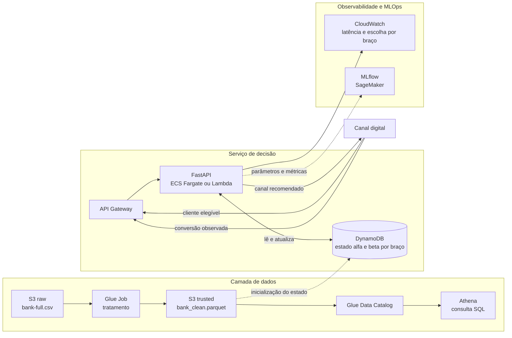

# Datathon 8MLET — Grupo 22

Plataforma de experimentação adaptativa para escolha de canal de contato em campanhas bancárias, usando Thompson Sampling.

**Integrantes:** 

Adriano Cabrera

- LinkedIn: https://www.linkedin.com/in/adriano-cabrera-b7b680a7/
- GitHub: https://github.com/cabrpin

Caio Grazzini

- LinkedIn: https://www.linkedin.com/in/caiograzzini/
- GitHub: https://github.com/Grazzica/

Fabrício Batista Dias

- LinkedIn: https://www.linkedin.com/in/fabriciobdias/
- GitHub: https://github.com/DiasFabricio
---

## 1. Problema de negócio

Uma instituição financeira precisa decidir por qual canal contatar cada cliente elegível em uma campanha de depósito a prazo. A abordagem tradicional é o teste A/B: dividir o tráfego igualmente entre os canais por um período e, ao final, escolher o vencedor. O custo dessa abordagem é o tráfego desperdiçado — durante todo o teste, metade dos contatos vai para o canal inferior.

Este projeto implementa uma política adaptativa (multi-armed bandit) que aprende qual canal converte melhor enquanto opera, reduzindo progressivamente o tráfego no canal inferior.

- **Braços (decisão):** canal de contato — `cellular` ou `telephone`
- **Recompensa:** conversão do cliente (assinatura do depósito a prazo)
- **Unidade de decisão:** uma campanha para um cliente

## 2. Base de dados

- **Fonte:** [Bank Term Deposit Subscription — dharmik34 (Kaggle)](https://www.kaggle.com/datasets/dharmik34/bank-term-deposit-subscription)
- **Arquivo utilizado:** `bank-full.csv` (45.211 registros, 17 colunas, separador `;`)
- **Origem:** redistribuição da base Bank Marketing do UCI (Moro et al., 2014)
- **Alvo:** `y` (yes/no)

### Tratamentos aplicados

| Decisão | Motivo |
|---|---|
| Remoção de `contact` = unknown (13.020 linhas) | Ausência de registro, não canal real. 96% concentrado em maio/junho e 99,5% em clientes sem campanha anterior |
| Remoção de `duration` | Vazamento temporal: só é conhecida após o contato |
| `pdays` desmembrada em `contatado_antes` e `dias_ultimo_contato` | O valor -1 misturava duas informações no mesmo campo |
| `poutcome` = unknown renomeado para `sem_campanha_anterior` | Representa ausência de campanha prévia, confirmado pelo cruzamento com `pdays` e `previous` |

Base final (camada trusted): 32.191 registros. Celular: 29.285 (14,92% de conversão). Telefone: 2.906 (13,42%).

## 3. Abordagem

### Baseline
Alocação uniforme (50/50), equivalente a um teste A/B tradicional.

O baseline "melhor braço histórico" não foi adotado: ele pressupõe que o melhor canal já é conhecido, o que elimina o problema que a política adaptativa resolve.

### Modelo adaptativo
Thompson Sampling com distribuição Beta por braço. Prior Beta(1,1), não informativo.

### Por que não contextual
A análise exploratória comparou os dois canais dentro de cada segmento de cliente. O celular vence em 27 das 33 células com volume suficiente. O único segmento favorável ao telefone (aposentados) se inverte ao controlar por idade — paradoxo de Simpson. Sem segmento em que a melhor decisão mude, um modelo contextual não teria o que aprender.

### Avaliação
Simulação por replay: a cada rodada a política escolhe um canal e observa o resultado de um cliente real sorteado do histórico daquele canal. 20.000 rodadas, 30 repetições com sementes distintas.

## 4. Resultados

| Política | Conversão | Desvio | Proporção celular |
|---|---|---|---|
| Uniforme (A/B 50/50) | 14,17% | 0,22 pp | 50,0% |
| Thompson Sampling | 14,67% | 0,25 pp | 87,1% |

Ganho de **0,50 ponto percentual**, aproximadamente 100 conversões adicionais a cada 20.000 contatos. Ao final da simulação a política adaptativa direciona 96% dos contatos ao celular, sem que essa informação tenha sido fornecida.

Os experimentos estão registrados no MLflow.

## 5. Golden set

Cinco clientes sorteados da base, com a recomendação da política treinada sobre o histórico completo.

| # | Idade | Profissão | Estado civil | Saldo | Canal recomendado | Canal no histórico | Converteu |
|---|---|---|---|---|---|---|---|
| 0 | 35 | student | single | 0 | cellular | telephone | não |
| 1 | 50 | technician | married | 232 | cellular | cellular | não |
| 2 | 47 | management | married | 1.675 | cellular | cellular | não |
| 3 | 34 | services | married | 2.956 | cellular | cellular | sim |
| 4 | 31 | entrepreneur | married | 162 | cellular | cellular | não |

**Estado aprendido:** celular α=4.370, β=24.917 (taxa estimada 14,92%); telefone α=391, β=2.517 (taxa estimada 13,45%). As estimativas convergiram para as taxas reais sem que estas tenham sido informadas.

Os cinco casos recomendam celular, resultado coerente com a política: como a incerteza sobre os braços já é baixa, a probabilidade de o sorteio favorecer o telefone é pequena. Por se tratar de um bandit não contextual, a recomendação não varia conforme o perfil do cliente — a variação entre chamadas decorre do sorteio das distribuições Beta. No caso 0, a recomendação diverge do canal efetivamente utilizado no histórico, que não resultou em conversão.

## 6. Limitações

- **Viés de seleção:** o canal não foi atribuído aleatoriamente no histórico. A comparação entre canais mistura o efeito do canal com o perfil de quem foi selecionado para cada um.
- **Diferença pequena entre braços:** 1,5 pp entre celular e telefone limita o ganho máximo possível.
- **Sem coluna de ano:** meses de anos diferentes aparecem agregados, impedindo separar sazonalidade de evolução do processo.
- **Modelo não contextual:** a recomendação não varia por perfil de cliente.
- **Serviço em notebook:** o estado da política é mantido em memória e se perde ao reiniciar o kernel. Em produção seria persistido em banco.

## 7. Arquitetura-alvo em nuvem (AWS)



Os dados brutos e tratados ficariam no Amazon S3, organizados nas camadas raw e trusted, com o Glue Data Catalog registrando os schemas e o Athena permitindo consulta SQL sobre os arquivos Parquet. O tratamento descrito na seção 2 seria executado por um job do Glue, disparado a cada nova carga.

O serviço de recomendação seria uma API em FastAPI, empacotada em contêiner no ECS Fargate ou publicada como função Lambda, dado o baixo custo computacional do Thompson Sampling, e exposta pelo API Gateway. O estado da política — os parâmetros alfa e beta de cada braço — seria mantido no DynamoDB, por exigir leitura e escrita de baixa latência a cada decisão. Cada conversão observada nos canais digitais retornaria à API e atualizaria esse estado, fechando o ciclo de aprendizado. O CloudWatch monitoraria latência, volume de decisões e a proporção de escolha de cada braço, indicador que sinaliza mudanças de comportamento dos canais, e o MLflow hospedado no SageMaker manteria o registro de experimentos.

## 8. Estrutura do repositório

```
├── data/
│   ├── raw/            # bank-full.csv (baixar do Kaggle, não versionado)
│   └── trusted/        # bank_clean.parquet
├── notebooks/
│   ├── 01_eda.ipynb                    # análise exploratória e tratamento
│   ├── 02_baseline_bandit.ipynb        # baseline, Thompson Sampling, golden set, MLflow
│   └── 03_servico_recomendacao.ipynb   # serviço de recomendação
├── requirements.txt
└── README.md
```

## 9. Como executar

```bash
# 1. Clonar e criar ambiente
git clone [URL DO REPOSITÓRIO]
cd [NOME DO REPOSITÓRIO]
python -m venv .venv
source .venv/bin/activate
pip install -r requirements.txt

# 2. Baixar bank-full.csv do Kaggle e salvar em data/raw/

# 3. Executar os notebooks em ordem
#    notebooks/01_eda.ipynb                — gera data/trusted/bank_clean.parquet
#    notebooks/02_baseline_bandit.ipynb    — simulação, comparação e registro no MLflow

# 4. Visualizar experimentos (na raiz do projeto)
mlflow ui --backend-store-uri sqlite:///mlflow.db
#    Abrir http://localhost:5000 e selecionar a aba "Model training"

# 5. Serviço de recomendação
#    Executar notebooks/03_servico_recomendacao.ipynb
#    A função recomendar(cliente) recebe os dados de um cliente e devolve o
#    canal recomendado; registrar_feedback(canal, converteu) atualiza a política
#    com o resultado observado.
```

## 10. Vídeo

[PREENCHER — link]
